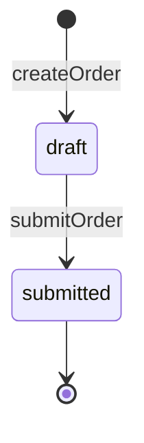

# API_DESIGN.md テンプレート（feature・バックエンド）

**目的**: 機能が持つ API の**意味**（いつ・なぜそのコードを返すか、判定の順序、冪等性、同時実行、副作用）を、
実装者がロジックを起こせる粒度で定義する。`docs.lineup: layered` の構成で使う。

**配置**: `.stdd.config.yml` の `docs.layout.api_design`（例: `docs/<feature>/API_DESIGN.md`）。API を持たない機能では作らない。

**API の形との分担**: パス・リクエストとレスポンスのスキーマ・HTTP ステータス・コードの値域は common の
[`API_SPEC.md`](./api-spec-common.md)（または OpenAPI などの定義ファイル）が正本である。本書は形を再定義せず、
操作名とレスポンスコードで参照する。

**レスポンスコード**: [レスポンスコード体系](../guides/response-codes.md)に従う（帯・1 分岐 1 コード・共通コード）。

## 章立ての骨格

| 章 | 内容 | 適用 |
| --- | --- | --- |
| 1. 操作 | 操作ごとの基本情報表・レスポンスコード・処理内容・応答仕様 | 常に |
| 2. 状態遷移 | 複数の操作にまたがる状態（ライフサイクル）と遷移表 | 常に（持たない機能は「なし」と 1 行書く） |
| 3. 機能ルール | REQUIREMENTS §2.2 の業務ルールの実現方法（判定表とコード） | 業務ルールがある場合 |
| 4. その他処理フロー | ユースケースに直接紐づかない処理（バッチ・定期処理・内部の整合処理） | 該当する場合 |
| 5. 設計判断 | この機能に特有の判断 | 該当する場合 |

章の番号は検査が章を見分ける手がかりなので、該当しない章を削除しても後ろの章の番号は詰めない。章 2 は削除せず「なし」と書く。

## テンプレート構造

````markdown
# [機能名] API 設計

> 要件は [`REQUIREMENTS.md`](./REQUIREMENTS.md)、API の形は [`API_SPEC.md`](../common/API_SPEC.md)、
> テスト設計は [`API_TEST_DESIGN.md`](./API_TEST_DESIGN.md) を参照。

## 1. 操作

### 1.1 `createOrder`

| 項目 | 内容 |
| --- | --- |
| 使用 API | `POST /api/orders`（[API_SPEC](../common/API_SPEC.md)） |
| 種別 | 作成 |
| 対応ユースケース | UC-<feature>-01 |
| 認可 | [実行できる主体の要約。判定は BR-<feature>-01] |
| 冪等性 | [なし ／ あり: 再送をどう識別し、どのコードで返すか] |
| 同時実行制御 | [なし ／ あり: 期待値の渡し方と、競合したときのコード] |
| トランザクション | [処理内容の手順 N〜M を 1 つのトランザクションで確定する ／ 参照のみ] |
| 副作用 | [なし ／ イベントの発行・通知・外部 API の呼び出し。発生する位置を手順の番号で示す] |

#### レスポンスコード

| コード | commonCode | HTTP | 発生条件 |
| --- | --- | --- | --- |
| `XXX-0001` | – | 201 | [正常に作成した] |
| `XXX-0002` | – | 200 | [同じキーで作成済みの対象を返した。呼び出し元が区別すべき結果が無ければこの行は書かない] |
| `XXX-1001` | – | 409 | [利用者が入力を直せば回復できる拒否の条件]（BR-<feature>-02） |
| `XXX-1800` | `VALIDATION_ERROR` | 422 | リクエストの形式違反 |
| `XXX-9001` | – | 403 | [権限が足りない条件]（BR-<feature>-01） |
| `XXX-9800` | `AUTH_REQUIRED` | 401 | 未認証 |
| `XXX-9820` | `NOT_FOUND` | 404 | [対象が存在しない。参照する権限が無い対象も同じ応答] |
| `XXX-9900` | `INTERNAL_ERROR` | 500 | サーバ内部のエラー |

#### 処理内容

1. **作成権限の検証**: BR-<feature>-01 を検証し、満たさなければ `XXX-9001` で終了する
2. **リクエストの検証**: API_SPEC のスキーマで検証し、違反は `XXX-1800` で終了する
3. **前提状態の検証**: [依存する他のリソースの状態]を検証し、満たさなければ `XXX-1001` で終了する
4. **[取得・導出の内容]**: [`table`] を [条件] で参照し、[計算式・変換]
5. **[エンティティ]の永続化**: [書き込む内容。削除なら物理削除か論理削除か]
6. **応答の返却**: `XXX-0001` で [返す内容] を返す

#### 応答仕様

- **一覧**: 既定の並び順（同じ値のときの順序まで決めて一意にする）・ページング（方式・上限・上限を超えたとき）・0 件のときのコード
- **導出・初期値**: 入力から自明でない項目の導出規則と初期値（未指定なら null になる、も書く）
- **`details` の構造**: `details` を返すコードについて、キー名・意味・任意のキーが載る条件

## 2. 状態遷移

なし（複数の操作にまたがる状態を持たない）

<!-- 状態を持つ機能は、上の 1 行を消してライフサイクルごとに次のブロックを置く -->

### 2.1 [ライフサイクル名]

**対象**: [どのリソースの状態か。状態の値域は API_SPEC が正本]



| ID | 遷移 | トリガ | ガード条件 | 副作用 |
| --- | --- | --- | --- | --- |
| TR-01 | 未作成 → draft | `createOrder` | BR-<feature>-01 | [なし] |
| TR-02 | draft → submitted | `submitOrder` | BR-<feature>-03 | [通知を送る] |

- **非同期の実行**〔非同期の操作を持つ場合〕: 進捗の観測手段・時間の上限・途中で止まった状態を誰がいつ回収するか・失敗後の再実行

## 3. 機能ルール

### BR-<feature>-01: [ルール名]

- [実現方法: 判定と、結果のコードへの割り当て]
- [境界条件・丸め・null の扱い]

### BR-<feature>-02: [判定表で表すルール]

| 条件 A | 条件 B | 結果 |
| --- | --- | --- |
| … | … | 許可 |
| … | … | `XXX-1001` |
| … | … | `XXX-9001` |

## 4. その他処理フロー

#### [処理フロー名]

**ID**: FL-<feature>-01

1. [契機]
2. [手順]

## 5. 設計判断

- [選択した設計] ／ **理由**: [1〜2 行]

テンプレート版: 1.0
````

## 記法ルール

- **処理は手順と計算式で書く。** 実装コード・関数名・クラス名は書かない。
- **操作は操作名で参照し**、リクエストとレスポンスの構造を再定義しない。
- **種別は次の語彙から選ぶ**（複数に当たるときはすべて書く）: `参照（単体）` / `参照（一覧）` / `参照（集約）` / `作成` / `更新` /
  `削除` / `状態遷移` / `非同期実行` / `ストリーミング配信` / `ファイル入出力` / `エクスポート`。
- **基本情報表の 8 行はすべての操作で必須。** 該当しない行も削除せず「なし」と書く。書き忘れと「なし」を区別するためである。
  冪等性・同時実行制御が「あり」の操作は、再送・競合のコードをレスポンスコードの表に持つ。
- **レスポンスコードの表には、その操作が返しうるコードをすべて載せる。** 正常系も結果の種類ごとに分ける
  （[レスポンスコード体系 §3.2](../guides/response-codes.md)）。共通コードも機能ごとの番号で行を置く。
- **処理内容の手順の並びは、実装の判定の順序と一致させる。** 順序を入れ替えると返るコードが変わる場合は、この並びが正である。
  応答を返して終わる手順には、返すコードを書く。
- **参照する権限が無い対象は、存在しない対象と同じ応答にする。** 403 は、対象が見えることを許したうえで操作を拒むときだけ使う。
- **状態遷移の表の行には `TR-NN` を振る**（章 2 の全体で通し番号。行を削除しても番号を詰めない）。状態遷移・非同期実行・
  ストリーミング配信の種別を持つ操作は、どれかの遷移表のトリガ列に現れる。
- **機能ルールの節見出しは REQUIREMENTS §2.2 の業務ルールの ID** にする。ルールの本文は REQUIREMENTS が正本で、本書は実現方法だけを書く。
  判定表の行の並びは評価の順序で、拒否の行ごとに別のコードを割り当てる。
- **その他処理フローの ID（`FL-<feature>-NN`）は本書の章 4 だけで宣言する**（見出し直下の `**ID**:` 行）。
- **ID を書く欄には ID を書く。** 「上と同じ」「§N を参照」のような参照で置き換えない。

## 記載基準チェックリスト

```
□ すべての操作が章 1 に節を持ち、基本情報表の 8 行が埋まっている（該当なしは「なし」）
□ 種別が規定の語彙から選ばれている
□ すべての操作に「レスポンスコード」と「処理内容」があり、処理内容の終了する手順にコードが書かれている
□ 正常系が結果の種類ごとに別のコードになっている（一覧の 0 件、冪等な作成の作成済み返却、更新の同値 など）
□ 冪等性・同時実行制御が「あり」の操作は、再送・競合のコードが表にある
□ 参照する権限が無い対象への応答が NOT_FOUND になり、権限不足の 403 と区別されている
□ 一覧を返す操作の応答仕様に、一意な並び順・ページング・0 件のときのコードがある
□ 機能固有のコードが連番 001〜799、共通コードが 800〜999 に収まっている（数字部は 4 桁）
□ 章 2 が「なし」の 1 行か、ライフサイクルごとの状態図と遷移表（TR-NN が通し番号）を持つ
□ すべての業務ルール（REQUIREMENTS §2.2）が章 3 に節を持ち、判定の結果がコードで書かれている
□ API_SPEC にある形（スキーマ・値域）を複製していない
□ 履歴・実装状態の記述が無い（SSOT 原則）
□ 末尾に「テンプレート版: X.Y」があり、その版が本テンプレートの更新履歴にある
```

## 記述しない内容（責務分界）

- パス・スキーマ・HTTP ステータスの一覧・コードの値域 → common の `API_SPEC.md`
- テーブル・カラムの定義 → common の `TABLE_DEFINITION.md`
- 受け取ったコードに対する画面の挙動と文言 → `SCREEN_DESIGN.md`
- テストの担保 → `API_TEST_DESIGN.md`・`TEST_DESIGN.md`
- ユースケース・受入基準・業務ルールの本文 → `REQUIREMENTS.md`

## テンプレート更新履歴

最新の行の版が現行版である。テンプレートを変えたら版を 0.1 上げ、作成済みの文書を新しい版に合わせる手順を書く。

| 版 | 変更内容 | 作成済みの文書の直し方 |
| --- | --- | --- |
| 1.0 | 初版 | — |
