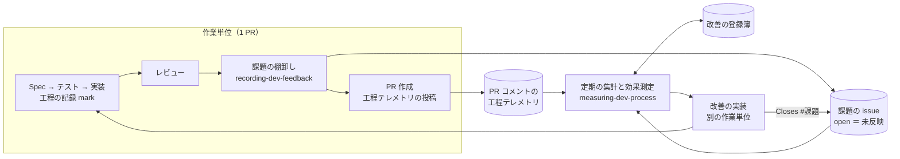

# フィードバックの収集と改善のループ

STDD 方法論（[`stdd-methodology.md`](stdd-methodology.md)）の一章。開発プロセスそのもの
（skill・agent・フック・検査スクリプト・規約・テンプレート）を、開発の実績から改善し続けるための仕組みを定める。

## 1. 目的

開発者や AI エージェントがどこでつまずき、何に時間がかかったかを、**聞き取りに頼らず開発の流れの中で集める**。
集めた課題と所要時間を定期的に集計し、次の改善を決め、その改善が効いたかを同じ指標で確かめる。

聞き取りやふりかえりの会議だけに頼ると、次のことが起きる。

- 記憶に残った出来事だけが課題になり、繰り返し起きている小さな手戻りが見えない。
- 改善を入れても、効いたかどうかを比べる数字がない。
- 同じ改善案が、過去に棄却された理由を知らないまま何度も出る。

## 2. ループの全体像



| 仕組み | 担当 | 置き場 |
| --- | --- | --- |
| 課題の起票 | `recording-dev-feedback` skill | GitHub issue（`feedback.labels.base` ラベル） |
| 工程テレメトリ | `create-pr` skill（`scripts/pr-telemetry.sh`）。工程の記録は `auto-implement` など | PR コメント |
| 定期の集計と効果測定 | `measuring-dev-process` skill（`scripts/collect.sh`） | 報告（Markdown） |
| 改善施策の登録簿 | `measuring-dev-process` skill | `feedback.registry`（既定 `docs/process/improvement-registry.md`） |

課題の規約（何を起票するか、優先度、上限、再発、見送り）の正本は
`recording-dev-feedback/references/feedback-rules.md` にある。この章はその背景と設計の考え方を書く。

## 3. 課題の起票

**レビューを終えたあと、PR を作る前に 1 回だけ**、その作業で生じたプロセス上の課題を棚卸しして起票する。

- **対象はプロセスの課題だけ。** 指示の不足、繰り返した手戻り、その場しのぎの判断、自動検査で防げたはずの欠陥。
  対象機能の仕様の誤りや実装のバグは、Spec やその PR の中で直す（STDD の一方向の流れの中で処理する）。
- **作業の途中では起票しない。** 気づいた時点では、その PR の中で直せるかが決まっていない。
- **1 つの Markdown ファイルに追記する方式は採らない。** 並行する複数の PR が同じファイルを編集して衝突し、
  起票を避ける動機になる。反映済みの項目が残り続け、「載っている ＝ 未対応」も保てない。
  issue にすれば、反映した PR の `Closes #<番号>` で自動的に閉じ、「open ＝ 未反映」を保てる。
- **ラベル・上限・再発コメントの書式・昇格の判定は、スクリプト（`dev-feedback.sh`）が確かめる。**
  何を起票するかの判断だけを人と AI が行う。

## 4. 在庫を増やしすぎない

**起票よりも反映のほうがボトルネックになる。** 起票は作業のたびに増えるが、反映には別の作業単位が要る。
規則がないと、未反映の在庫は際限なく増え、重複確認と棚卸しの手間だけが増える。そのため次の 3 つの規則を一緒に置く。

| 規則 | 内容 | 理由 |
| --- | --- | --- |
| 低い優先度は起票しない | 「いつ直しても損失が変わらない」ものは起票しない | 起票しても損失は減らず、在庫だけが増える |
| 1 PR あたりの上限 | 既定 5 件。束ねてから数え、再発コメントは数えない | 流入を反映の能力に合わせる。起票しなかった件数は記録し、上限の妥当性を後から確かめる |
| 見送り | `priority:medium` で 14 日動きのないものは `not planned` で閉じる。再発したら reopen する | すでに積まれた在庫を減らす。再発が拾い直しの経路になる |

優先度は作業量ではなく、**「後回しにしたときの損失が時間とともに増えるか」**で決める。
同じ課題の再発コメントが 2 本に達したら `priority:high` に上げる。

**見送りは定期実行で自動化せず、集計のときに人が当てる。** 見送りと再発時の拾い直しは対で動く必要がある。
CI の権限の都合などで拾い直しだけが動かないと、閉じたまま誰も気づかない issue が生まれる。
候補の抽出と、閉じる直前の条件の再確認はスクリプトが行い、いつ当てるかを人が決める。

## 5. 工程テレメトリ

**PR を作った直後に、PR ごとの工程の記録を PR コメントとして投稿する。** レビューを省いた PR でも投稿する
（投稿されない PR が特定の種類に偏ると、集計の結論が歪む）。

項目は、レビュー工程の進め方に依存しない最小限にしている。

| 項目 | 内容 | 出所 |
| --- | --- | --- |
| `head_sha` / `base` / `pr` | どの断面の記録か | `gh pr view` |
| `size` | 変更ファイル数・追加行数・削除行数・コミット数 | `gh pr view` |
| `duration_min.lead_time` | 最初の記録か最初のコミットから、投稿までの分 | 工程の記録と git |
| `duration_min.steps` | 工程（`spec` / `plan` / `test` / `implement` / `qa` / `review`）ごとの分 | 工程の記録（`pr-telemetry.sh mark`） |
| `review.rounds` | レビューの回数 | 工程の記録、または申告 |
| `review.findings` | PR 前レビューの台帳の指摘の件数と処置の内訳（`total` / `fix` / `file` / `may_defer`）。台帳が無ければ `null` | `review-ledger.sh summary`（[`review-process.md`](review-process.md)） |
| `review.independent` | 別のモデルでレビューしたか（`true` / `false` / ラウンドで混在なら `"mixed"`） | 同上 |
| `review.unproven` | 実行で確かめられず台帳に載せなかったテスト・コードの指摘の、担当ごとの件数 | 同上 |
| `review.exempt` | レビューをしなかった理由の区分（`typo_format_only` / `link_fix_only` / `regenerate_only` / `user_waived`）。緊急モードの PR は、レビューの有無に関わらず `emergency`（[`work-modes-and-limits.md`](work-modes-and-limits.md)） | 申告 |
| `feedback` | 棚卸しの結果（起票数・再発コメント数・上限で起票しなかった数） | `dev-feedback.sh` の記録 |

設計の考え方:

- **測れなかった値は `null` にし、0 と区別する。** 記録の無い工程を「0 分」と読むと、速くなったと誤解する。
- **置き場はリポジトリではなく PR コメント。** コミットする記録ファイルは、課題の台帳と同じく並行する PR の衝突を生む。
  横断の集計は保存せず、集計のたびに PR コメントから導く。
- **工程の記録は作業ツリーの外に置く**（git の共通ディレクトリ配下）。コミットにも差分にも入らない。
- **投稿したら読み直して確かめる。** コマンドが成功しても、PR から読めるとは限らない。
- **PR コメントは自己申告で、署名はない。** 集計ではリポジトリのメンバーのコメントだけを読むが、偽造を防ぐ仕組みではない。
  傾向を読む材料として扱い、判断の根拠にするときは PR を開いて確かめる。
- **レビュー工程に固有の指標**は、PR 前レビュー（[`review-process.md`](review-process.md)）の台帳から読めるもの
  （指摘の件数と処置の内訳・独立性・実行で確かめられなかった件数）だけを `schema` の版 2 で足した。レビュー担当ごとの所要や、
  修正が新しい欠陥を生んだ割合などは含めていない。版 1 の記録も集計では読める。

## 6. 定期の集計と効果測定

間隔は決めず、在庫が気になったときや施策を入れて一定期間たったときに回す。1 周は次の順で進める。

1. **集める** — 収集スクリプトで窓を切って集計する。集計のたびに使い捨てのスクリプトを書かない（定義が揺れて比べられなくなる）。
2. **計器を疑う** — 集計の定義・入力の偏り・母集団の欠けを、数字を読む前に確かめる。
3. **前回の施策を判定する** — 登録簿に書いた指標で、効いた／部分／効いていない／打ち消された／測れない／未判定のどれかを付ける。
   「測れない」を「効いていない」に丸めない。
4. **詰まりを特定する** — 時間・滞留・繰り返しの 3 つの面で上位を採る。
5. **在庫を整理する** — ラベルの不整合の修正、昇格、見送りを当てる。
6. **既存を確かめてから提案する** — 現在の主ブランチの仕組み、過去の判断、棄却済みの案に当ててから出す。
   既にある仕組みが効いていないなら、提案は新設ではなく「効かない理由の修正」になる。
7. **報告して登録簿を更新する。**

### 改善施策の登録簿

施策ごとに、**狙う指標と判定の履歴**を残す。あわせて、施策の方向を決めた判断、棄却した案、計器の既知の問題も同じ場所に残す。
施策の行は消さない。効かなかった施策も、同じ案を再び出さないための記録になる。

## 7. 規律と自動化の対応

規律を文章で書くだけでは、関わる agent や人が増えるほど守られなくなる。この章で加えた規律は、
次の手段で自動的に確かめる。自動化していないものは理由を残す。

| 規律 | 確かめる手段 | 自動化しない部分と理由 |
| --- | --- | --- |
| PR を作る前に課題を棚卸しする | skill の手順（`auto-implement` Phase 4.8）。棚卸しの記録が無いと `pr-telemetry.sh verify` が警告する | 何を起票するかは判断を伴うので、自動化しない |
| 低い優先度は起票しない | `dev-feedback.sh file` が `low` を拒否する | 優先度の判定そのものは判断を伴う |
| 優先度はちょうど 1 つ、分類は 1 つ以上 | `file` が付けるラベルを固定する。手で付けたものは `audit` が一覧する | 人が Web から起票する経路は GitHub Actions で検査できるが、`stdd init` は `.github/` を配らないので既定にしない |
| 1 PR あたりの上限 | `file` が、発生源のブランチで数えて上限に達したら止める | — |
| 再発コメントの書式と、再発による reopen・昇格 | `dev-feedback.sh recur` が書式を固定し、規約どおりに reopen・昇格する | — |
| 見送り | `audit` が候補を出し、`close-stale` が閉じる直前に条件を取り直す | いつ当てるかは人が決める（§4） |
| PR ごとにテレメトリを投稿する | `create-pr` が `pr-telemetry.sh post` を実行し、PR から読み直して確かめる。失敗したら PR 作成を完了としない | CI の必須チェックにはしない（PR の作成を止めるほどの重さはない。抜けは集計の「テレメトリの無い PR」で見える） |
| レビューしなかった PR は理由を申告する | `post` が、レビューの記録も申告も無いときに止まる。区分は列挙の中だけ受け付ける | — |
| 提案の前に既存の仕組み・判断・棄却済みの案を確かめる | `measuring-dev-process` の手順と報告の表の欄 | 判断を伴うので自動化しない |

## 8. 設定

`.stdd.config.yml` の `feedback` と `telemetry` で調整する（定義は `packages/core/schema/.stdd.config.schema.json`）。
どの値にも既定値があるので、導入直後から使える。

```yaml
feedback:
  enabled: true
  labels:
    base: "dev-feedback"
    priority_high: "priority:high"
    priority_medium: "priority:medium"
    category_prefix: "category:"
  max_issues_per_pr: 5
  stale_days: 14
  recurrence_to_high: 2
  registry: "docs/process/improvement-registry.md"
telemetry:
  enabled: true
```

- GitHub の issue と PR コメント、`gh` コマンドを前提にしている。使えない環境では、skill は起票と投稿を省いて先へ進む。
- ラベルは最初の起票の前に `dev-feedback.sh setup` で作る（冪等）。
- 人が Web から起票する場合は、`recording-dev-feedback/templates/dev-feedback.yml` を `.github/ISSUE_TEMPLATE/` に置く。
