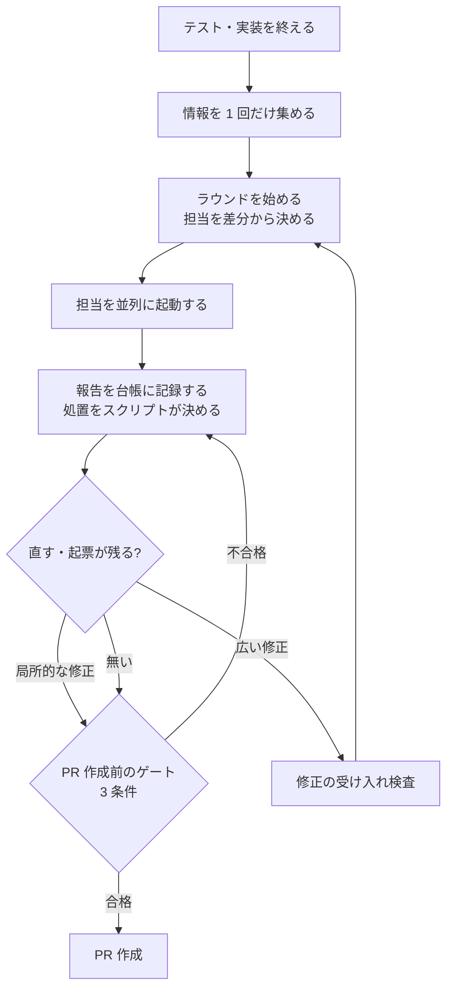

# PR 前レビュー

STDD 方法論（[`stdd-methodology.md`](stdd-methodology.md)）の一章。レビューを PR を作る前に置き、複数のラウンドで回すための
構成・記録・終え方を定める。手順の正本は `reviewing-changes` skill、台帳と判定の正本は同じ skill の
`scripts/review-ledger.sh` である。

## 1. 目的と方針

PR を作ってからレビューすると、指摘を直すたびに PR の中身が変わり、どの断面を誰が見たのかが分からなくなる。
そこで STDD では、レビューを PR を作る前に回し、指摘を台帳に記録して直してから PR を作る。

- **止める場所は PR を作る直前の 1 か所だけにする。** そこで確かめる条件は 3 つに絞る（§7）。
  レビューの途中の記録の不備は止めずに警告にとどめる。
- **テストと機械検査は CI に任せる。** ローカルでのテストや検査の完走を、PR を作る条件にしない。
  ローカルで全件を回す時間と、その結果を条件にしたときの誤判定のほうが、得られる安心より大きいためである。
- **reviewer は評価だけを書き、処置はスクリプトが決める。** 指摘の重さの付け方が reviewer ごとにぶれても、
  直すかどうかの判断がぶれないようにする。

作成済みの PR を後からレビューしたいときも、同じ skill を PR を指定して使う。

## 2. 流れ

auto-implement では Phase 3（QA）と Phase 4（コードレビュー）がこの流れになる。Spec のレビュー（Phase 1a / 1b）と
テストのレビュー（Phase 2.5）は、それぞれの工程の中で行い、人間レビューゲートの前提になる。

## 3. 担当の起動

担当は差分から決める。常に起動する横断の担当に加え、突合・要件・技術設計・テスト・コード・セキュリティの担当を、
差分に当たるファイルがあるときに起動する。条件は `.stdd.config.yml` の `review.triggers`（パスの正規表現）で変えられる。
起動しなかった担当と、その理由も台帳に残す。

| 担当 | agent | 見るもの |
| --- | --- | --- |
| 横断 | `qa-engineer` | 変更全体の論理の誤り・境界値・変更の影響 |
| 突合 | `qa-engineer` | Spec ⇔ テスト ⇔ 実装の対応、要件 ID の追跡 |
| 要件・技術設計 | `requirements-reviewer`・`tech-specs-reviewer` | 変更した Spec |
| テスト | `test-reviewer` | 変更したテスト |
| 規約と品質・性能とエラー処理・セキュリティ | `code-reviewer`（観点ごとに 1 体） | 変更した実装 |

- 起動する担当は、既定で並列に起動する。agent teams が使えるならそれを使う（[`skill-and-agent.md`](skill-and-agent.md) §2）。
- セキュリティは `code-reviewer` のセキュリティの観点が受け持つ。攻撃する側の視点の専用の担当は置かない。
- 情報（差分・紐づく ID・Spec のパス）はメインのセッションが 1 回だけ集めて全担当に配る。書いたときの判断の理由は渡さない。
- **独立レビューは推奨にとどめる。** 別のモデルでレビューできる環境なら、少なくとも 1 担当を別のモデルで回す。
  できなければ同じモデルで回し、独立性が無いことを工程テレメトリに残す。複数のモデルに同じ差分を壊させて
  結果を突き合わせる形も、同じく推奨にとどめる。

## 4. 指摘の判断基準

この判断基準は、PR 前レビューだけでなく、STDD のすべてのレビュー（auto-implement の Phase 1a・1b・2.5 を含む）に使う。

reviewer は指摘ごとに、**発生条件**・**頻度**（常時・条件付き・稀）・**影響**（致命・支障・軽微）・**影響先** の 4 項目と、
**確信の段階**を書く。書き方の目安は `reviewing-changes` の `references/reporting.md` にあり、実装・テスト・ハーネスの目安と、
Spec の目安（頻度は「この記述を読んで実装する人が毎回引っかかるか」）を分けて持つ。

- 影響は「起きたとき、誰かが気づけるか・戻せるか・誰かの判断を誤らせるか」で判定する。
- 種別（プロダクトの指摘か、ハーネスの指摘か）と範囲（全体・複数・単一）は、差分と影響先から機械が決める。
  種別は差分がハーネスのファイルだけかどうか（`review.harness_paths`）、範囲は影響先の数と、
  全体に及ぶ語やパス（`review.global_words`・`review.global_paths`）で決める。
- 頻度と範囲から起こりやすさ（高・中・低）を決め、種別・起こりやすさ・影響から処置（直す・起票・見送り可）を決める。
  **2 つの表は `review-ledger.sh` の中にだけ置き、文書に転記しない**（`review-ledger.sh table` で表示できる）。
- 重大度（Critical・Major・Minor、High・Medium・Low）と、reviewer の総合判定（PASS など）は使わない。
- **進む・止まるの条件は、処置が「直す」の指摘が 0 件であること**（「起票」は issue があること）。PR 前レビューの終わりも、
  Phase 1a・1b・2.5 の差し戻しも、この条件で決める。
- メインのセッションは 4 項目を上げることはできるが、下げることはできない。
- セキュリティの観点の指摘は頻度を評価しない。攻撃する側は稀な条件を自分で作れるためである。処置は影響だけで決め、
  軽微でも起票する。

**確信の段階との関係**: `assessing-change-impact` §1 の確信の段階（1〜5）は、指摘をどこまで確かめたかを表す。
4 項目は、起きたらどれくらい困るかを表す。別の物差しなので、台帳では両方を並べて持つ（確信の段階は「根拠」の列）。

この判断基準は、効果をまだ測っていない。工程テレメトリ（[`feedback-loop.md`](feedback-loop.md) §5）の処置の内訳と、
終わるまでのラウンド数を集計し、見送った指摘が後で不具合になっていないかを確かめてから見直す。

## 5. 「直す」のコードとテストの指摘は実行で確かめる

テストとコードの担当（`test-reviewer` と、`code-reviewer` の 3 つの観点）の指摘のうち、処置が「直す」になるものは、
**確信の段階 4 以上（実行して確かめた）** を求める。

- reviewer は、自分の作業ツリー（`isolation: worktree`）でレビューするコミットに切り替え、再現の手順（コマンド）を実行して、
  意図した出力と実際の出力を付ける。メインのセッションは、その手順をもう一度実行して確かめる。
- 作業ツリーを分けられない場合（Codex、作業ツリーを分けずに動く agent teams のメンバー）は、reviewer はシェルを読み取りにだけ使い
  （[`discipline-automation.md`](discipline-automation.md) §3.1）、手順を書く。メインのセッションが、レビューしたコミットから作った
  使い捨ての作業ツリーで実行する。PR のブランチの作業ツリーは汚さない（[`parallel-work.md`](parallel-work.md)）。
- 確かめられなかった「直す」の指摘は「未確認」として別に並べ、終わりの条件に数えない。件数は担当ごとに工程テレメトリに出す。
- 書き方・命名・構造の好み、将来の変更で初めて問題になるリスクは、これらの担当の指摘に含めない。
- 要件や設計の指摘は実行で確かめられないので、Spec の目安で 4 項目を付ける。確信の段階の条件は課さない。

この考え方は [pstack](https://github.com/cursor/plugins/tree/main/pstack) の `interrogate` と `arena`（MIT）による。
STDD の工程と reviewer の制約に合わせて書き直した。

## 6. 台帳とラウンド

- **台帳**の列は、指摘 ID・ラウンド・担当・4 項目・種別・範囲・起こりやすさ・処置（直す・起票・見送り可・未確認）・状態・根拠（確信の段階）である。
  置き場は作業ツリーの外（git の共通ディレクトリ配下）で、コミットにも差分にも入らない。書き込みは `review-ledger.sh` が行う。
- **ラウンド**は、始めた時点のコミット 1 つに対して行う。ラウンドの途中で修正をコミットしない（違反は警告にとどめる）。
- ラウンドの数に上限は設けない。
- **修正の受け入れ検査**は、回し直す前に行う助言であり、ゲートの条件にしない。修正をわざと壊してテストが失敗することを
  確かめる変異の実行は技術スタックに依存するので、プラグインに置く。結果は「直す・現在も正しいと確認した・見送る（理由）」に
  仕分けて報告に書く。

## 7. PR 作成前のゲート

`gh pr create` の直前に、フック `review-gate.sh` が `review-ledger.sh gate` を呼んで次の 3 条件を確かめる。

1. **PR の中身がレビューされている。** 最後のラウンドでレビューしたコミットが HEAD の祖先であり、その後のコミットは、
   台帳の修正済みの指摘が指す修正だけである（主ブランチの取り込みは除く）。
2. **直すべき指摘が残っていない。** 処置が「直す」の指摘がすべて修正済みである。処置が「起票」の指摘は、issue が作られている。
3. **指摘が記録から漏れていない。** 起動した担当の報告がすべて記録され、報告の末尾の指摘 ID がすべて台帳に載っている。

- 強さは `workflow.enforce_review_gate`（`off` / `warn` / `block`。既定は `warn`）。誤検知が無いことを確かめてから `block` に上げる。
- レビューの要らない PR（誤字の修正だけなど）は、`STDD_REVIEW_GATE_SKIP_REASON="<理由>"` を前置して作る。
- レビューした時点と PR の中身の完全な一致は求めない。修正のたびに回し直すことになり、終わらなくなるためである。

## 8. 緊急モード

緊急モードのブランチでは、ラウンドを省くか 1 回で打ち切ってよく、ゲートの不合格は警告にとどまる
（[`work-modes-and-limits.md`](work-modes-and-limits.md)、`choosing-work-mode` §3）。

## 9. 規律と自動化の対応

| 規律 | 確かめる手段 | 自動化しない部分と理由 |
| --- | --- | --- |
| PR はレビューを通してから作る（3 条件） | フック `review-gate.sh` と `review-ledger.sh gate`（テスト `bash test/review-gate.test.sh`） | `gh pr create` 以外の方法（Web の画面・API）で作る PR は確かめられない |
| 処置は 4 項目から表で決め、4 項目は下げない | `review-ledger.sh` の `add` / `raise` | reviewer が書く 4 項目の妥当性は判断を伴う |
| 重大度と reviewer の総合判定を使わない | テスト `bash test/review-gate.test.sh`（agent・auto-implement・reviewing-changes に重大度の書式が無いことを確かめる） | 文章の中の言い回しまでは見ない |
| 処置の表は 1 か所だけに置く | テスト `bash test/review-gate.test.sh`（文書に表の行が無いことを確かめる） | — |
| 「直す」のテストとコードの指摘は確信の段階 4 以上を求める | `review-ledger.sh add` / `derive`（4 未満なら処置を未確認にする） | 実際に実行したかどうかはメインのセッションの申告による |
| ラウンドの途中で修正をコミットしない | `review-ledger.sh round end` の警告 | 止めない（記録の不備はゲートの条件にしない方針） |
| 修正の受け入れ検査 | skill の手順（助言） | ゲートにしない。変異の実行は技術スタックに依存する |
